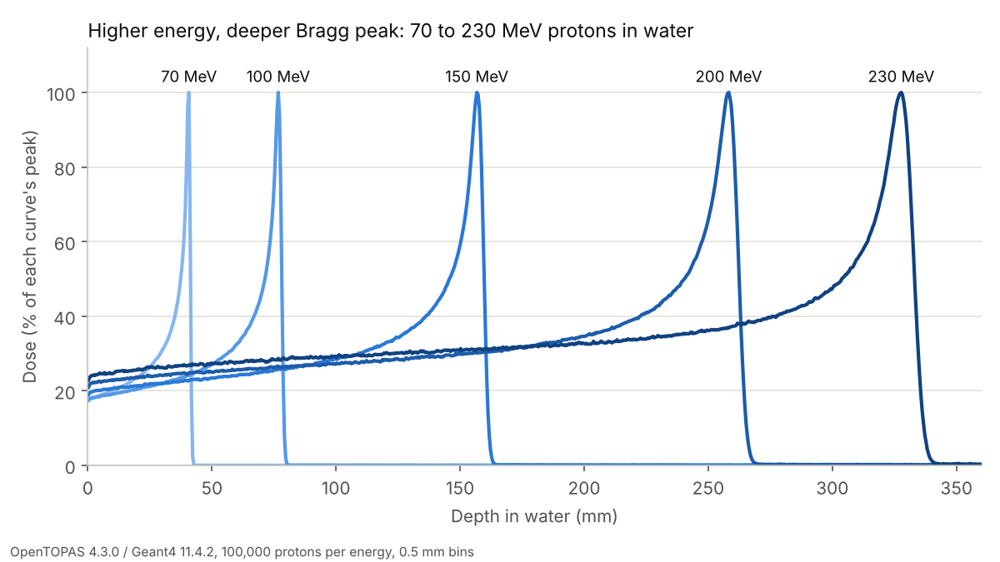

# Protons in a magnet

A Monte Carlo study of how a clinical proton beam is bent by the magnetic field of an MRI scanner, built with
open tools (OpenTOPAS / Geant4) and validated against reference data first.



## Why

MRI-guided proton therapy would let clinicians see a tumour while treating it, but the scanner's 0.5-1.5 T field
deflects the proton beam and shifts the Bragg peak. Treatment planning has to predict that shift. This project
reproduces that physics step: first a validated proton beam in water, then the beam in a transverse field, compared
with an independent Lorentz-force model and published results (see [PROJECT_PLAN.md](PROJECT_PLAN.md)).

## Status (10 Oct 2026)

| Stage | What | Status |
|---|---|---|
| 1 | Install OpenTOPAS 4.3.0 (Docker), smoke test | done 9 Oct |
| 2 | First Bragg peak, 150 MeV in water | done 9 Oct |
| 3 | Validation sweep 70-230 MeV against PSTAR | runs done 10 Oct; reference values still provisional |
| 4 | Magnetic field on (0.5 / 1.0 / 1.5 T) | planned from 26 Oct |
| 5-6 | Own Lorentz-force model, rotation-angle lookup table | planned |

## Result so far: range validation

R80 (depth where the dose falls to 80 % of its peak, beyond the peak) against the proton range in water from NIST
PSTAR. Every energy is inside the ±1 % acceptance band set in the plan, with a systematic offset of about +0.5 %.


| Energy (MeV) | Peak depth (mm) | R80 (mm) | Reference (mm) | R80 − ref (mm) | Fall-off R20−R80 (mm) | Stat. unc. at peak |
|---|---|---|---|---|---|---|
| 70 | 40.75 | 41.02 | 40.80 | +0.22 (0.5 %) | 0.72 | 0.21 % |
| 100 | 76.75 | 77.59 | 77.18 | +0.41 (0.5 %) | 1.23 | 0.24 % |
| 150 | 156.75 | 158.63 | 157.70 | +0.93 (0.6 %) | 2.30 | 0.29 % |
| 200 | 258.25 | 260.70 | 259.60 | +1.10 (0.4 %) | 3.71 | 0.35 % |
| 230 | 327.75 | 330.95 | 329.50 | +1.45 (0.4 %) | 4.63 | 0.39 % |

100,000 protons per energy; full table in [results/stage3/summary.csv](results/stage3/summary.csv).

**Likely cause of the +0.5 % offset (hypothesis, not yet tested):** Geant4's `g4em-standard_opt4` uses ICRU
Report 90 water data (mean excitation energy 78 eV) while PSTAR uses 75 eV; a slightly higher value means slightly
weaker stopping and a longer range. A rough Bethe-formula estimate gives about +0.5 %. Next: rerun with ICRU 90
off and download PSTAR directly ([data/reference/SOURCE.md](data/reference/SOURCE.md)).

## Simulation set-up

- 40 × 40 × 40 cm `G4_WATER` phantom in vacuum, depth dose scored in 800 slabs of 0.5 mm
- Mono-energetic proton pencil beam, Gaussian spot σ = 3 mm, parallel, entering on the phantom axis
- Physics: TOPAS default modular list (`g4em-standard_opt4`, `g4h-phy_QGSP_BIC_HP`, `g4decay`,
  `g4ion-binarycascade`, `g4h-elastic_HP`, `g4stopping`)
- 100,000 histories, fixed seed 1, 12 threads; about 1 minute per energy on a desktop PC

Parameter files: [topas/runs/](topas/runs/).

## Reproduce

Needs Docker and the Geant4 11.4.2 data sets (3.4 GB). Windows step-by-step: [docs/setup-windows.md](docs/setup-windows.md).

```bash
bash scripts/get_g4data.sh                      # once: Geant4 data into ~/G4DATA
pip install -r requirements.txt
scripts/run_sweep.sh                            # 5 energies -> results/stage3/, then table + figures
# or from the saved results only:
python -m analysis.summarize && python -m analysis.figures
pytest -q
```

## Repository layout

```
topas/runs/          OpenTOPAS parameter files, one per run: E{MeV}_B{tesla}.txt
scripts/             run.sh (one run in Docker), run_sweep.sh, get_g4data.sh, plot_depth_dose.py
analysis/            io.py (read TOPAS CSV), metrics.py (R80 etc.), reference.py, summarize.py, figures.py
data/reference/      reference ranges + SOURCE.md
results/stage3/      raw TOPAS output for the validation sweep + summary.csv
figures/             figures made by analysis/figures.py
tests/               pytest on synthetic curves with known answers
docs/                setup guide, project log, learning log, targets
```

## Versions

OpenTOPAS 4.3.0 · Geant4 11.4.2 (geant4-11-04-patch-02) · Docker image
`opentopas/opentopas:v4.3.0-geant4-11.4.2` (published 2026-09-18) · Python 3 with numpy, scipy, pandas, matplotlib.

## About

By Vishvam (BSc Physics, Lund University; MSc Particles and Cosmos, Stockholm University), as a portfolio project
in medical physics. Built with help from Claude (Anthropic) for code and set-up; the physics choices, runs and
interpretation are documented in [docs/log.md](docs/log.md). Licence: MIT.
