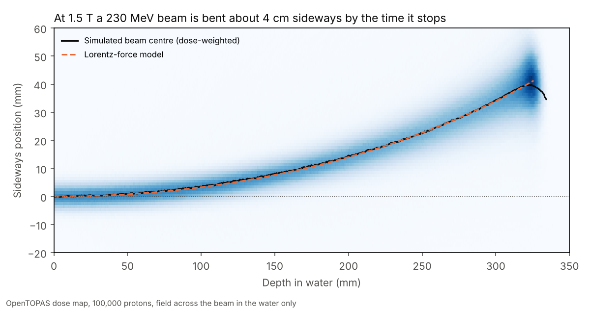
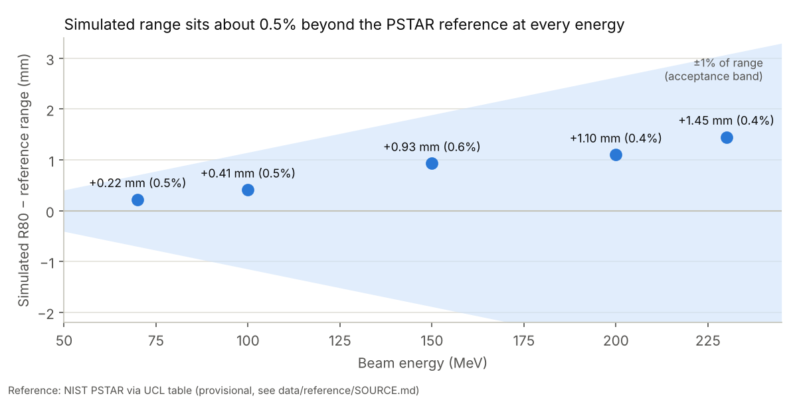
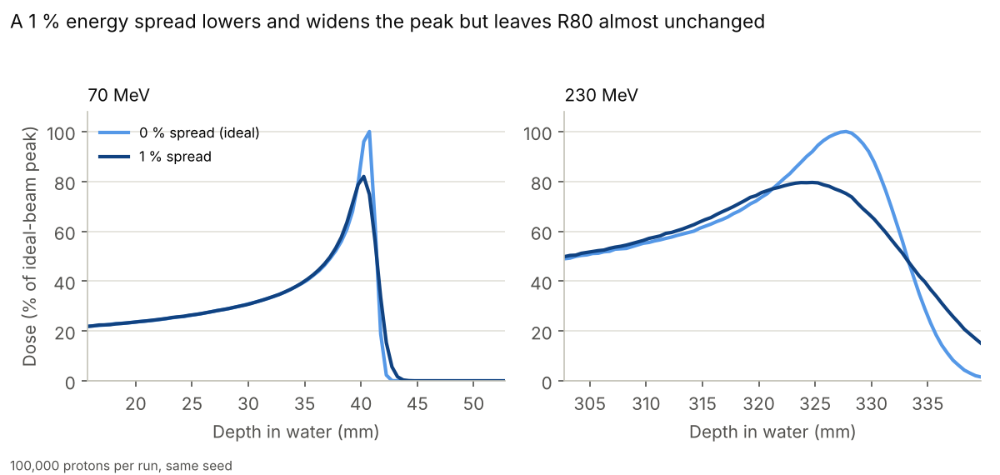
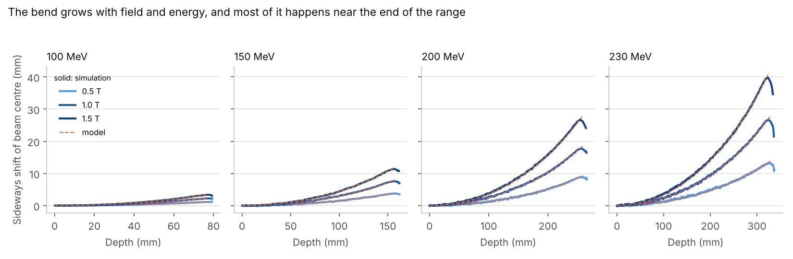
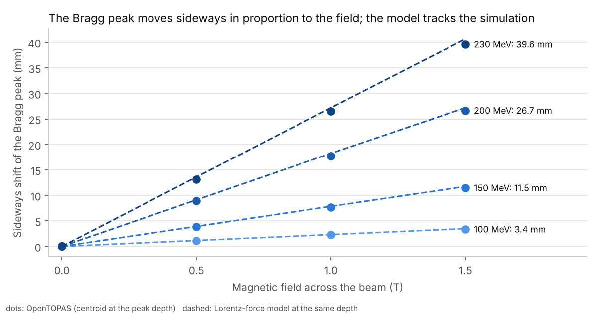
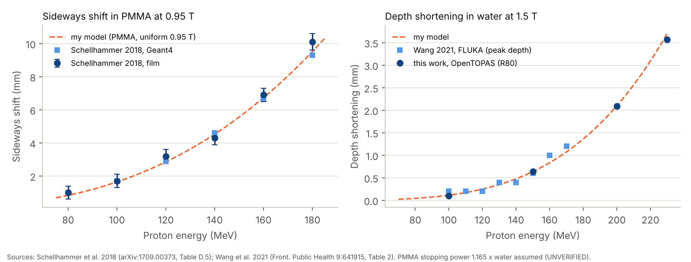

# Protons in a magnet

**How much does an MRI scanner's magnetic field bend a proton therapy beam?** This project answers that with a
Monte Carlo simulation (OpenTOPAS / Geant4). First it shows that the simulated beam stops where reference data say
it should. Then it turns on a magnetic field and measures how far the Bragg peak moves.



> **Results (10 Oct 2026)**
> - **Validation:** at five energies from 70 to 230 MeV, the simulated range lands within **0.6 %** of NIST PSTAR.
>   The +0.5 % offset is explained: Geant4 water has a mean excitation energy of 78 eV, PSTAR uses 75 eV.
>   With 75 eV water the offset drops to −0.1 to −0.2 %.
> - **Magnetic field:** at 1.5 T the Bragg peak moves sideways by **3.4 mm at 100 MeV** up to **39.6 mm at
>   230 MeV**, and it ends up to 3.6 mm less deep. The shift grows linearly with the field.
> - **Cross-check:** my own Lorentz-force model agrees with the simulation within 5 % (≤ 1.1 mm) and matches
>   published film and Monte Carlo data (Schellhammer et al. 2018, Wang et al. 2021).

**Contents:** [Background](#background) · [Method](#method) · [Results](#results) · [Reproduce](#reproduce) ·
[Repository layout](#repository-layout) · [Roadmap](#roadmap) · [Versions](#versions)

## Background

Proton therapy puts most of its dose in a sharp peak (the **Bragg peak**) at a depth set by the beam energy, and
almost nothing beyond it. That makes it precise, but only if you know exactly where the protons stop. Treating
inside an MRI scanner would let clinicians *see* the tumour during treatment. However, the scanner's 0.5-1.5 T
field bends the charged proton beam sideways and shifts the peak. Treatment planning has to predict that shift.

This project rebuilds that prediction with open tools, step by step:

1. **Validate** a proton pencil beam in water against reference ranges (NIST PSTAR).
2. **Deflect** it with a uniform transverse field of 0.5, 1.0 and 1.5 T and measure the lateral shift and range
   change of the Bragg peak.
3. **Cross-check** against an independent Lorentz-force model and published results (Wolf & Bortfeld 2012,
   Schellhammer et al. 2018, Wang et al. 2021).

The approach follows the lookup-table method PSI uses for its MRI-guided proton dose engine (Duetschler et al.,
*Phys. Med. Biol.* 2023, doi:10.1088/1361-6560/acf90d). Full plan and timeline: [PROJECT_PLAN.md](PROJECT_PLAN.md).

## Method

| | |
|---|---|
| **Geometry** | 40 × 40 × 40 cm block of `G4_WATER` in vacuum; dose scored in 800 depth slices of 0.5 mm |
| **Beam** | proton pencil beam, Gaussian spot σ = 3 mm, parallel, on the phantom axis. Stage 3: no energy spread (ideal beam, clean comparison with PSTAR). Stage 3b: 1 % (1σ) energy spread, closer to a clinical beam |
| **Field** (Stage 4) | uniform `DipoleMagnet` inside the water only, along y (across the beam); 0, 0.5, 1.0, 1.5 T at 100, 150, 200, 230 MeV. A second scorer records an x-z dose map (1 mm × 0.5 mm bins) |
| **Physics** | OpenTOPAS default list: `g4em-standard_opt4`, `g4h-phy_QGSP_BIC_HP`, `g4decay`, `g4ion-binarycascade`, `g4h-elastic_HP`, `g4stopping` |
| **Statistics** | 100,000 protons per run, fixed random seed, 12 threads, 1-4 minutes per run |
| **Range metrics** | R80, R90 and R20 (depths beyond the peak where the dose falls to 80/90/20 % of its maximum), found by linear interpolation between slices; distal fall-off = R20 − R80 |
| **Sideways shift** | dose-weighted mean x in each depth slice; the shift of the Bragg peak is that centroid at the peak depth, relative to the 0 T run |
| **Own model** (Stage 5) | one "average" proton: dT/ds = −S(T) from the PSTAR table, and the direction turns at 1/R with R = p/(qB). Integrated with `scipy.integrate.solve_ivp` ([analysis/lorentz_ode.py](analysis/lorentz_ode.py)). No scattering or straggling |
| **Uncertainty** | OpenTOPAS reports the standard deviation per proton; the uncertainty of the summed dose is that × √N |

Run files: [topas/runs/](topas/runs/). Analysis code: [analysis/](analysis/), with tests in [tests/](tests/).

## Results

### Stage 3: range validation



| Energy (MeV) | Peak depth (mm) | R80 (mm) | PSTAR range (mm) | R80 − PSTAR (mm) | Fall-off R20−R80 (mm) | Stat. unc. at peak |
|---|---|---|---|---|---|---|
| 70 | 40.75 | 41.02 | 40.80 | +0.22 (0.5 %) | 0.72 | 0.21 % |
| 100 | 76.75 | 77.59 | 77.18 | +0.41 (0.5 %) | 1.23 | 0.24 % |
| 150 | 156.75 | 158.63 | 157.70 | +0.93 (0.6 %) | 2.30 | 0.29 % |
| 200 | 258.25 | 260.70 | 259.60 | +1.10 (0.4 %) | 3.71 | 0.35 % |
| 230 | 327.75 | 330.95 | 329.47 | +1.48 (0.4 %) | 4.63 | 0.39 % |

100,000 protons per energy. PSTAR = CSDA range in liquid water from the NIST table
([data/reference/](data/reference/SOURCE.md)). Full table: [results/stage3/summary.csv](results/stage3/summary.csv).

- **Every energy passes** the threshold of ≤ 1 mm or ≤ 1 % of the range.
- **The offset is the same in percent (about +0.5 %), not in millimetres.** That points to the stopping power of
  water, not to geometry or binning.
- **Cause found (offset test, 3 extra energies each):** `G4_WATER` has a mean excitation energy I = 78 eV, PSTAR
  uses 75 eV. A higher I means slightly less energy loss per mm, so a longer range.

  | Energy (MeV) | R80 − PSTAR, default | ICRU 90 data off | water with I = 75 eV |
  |---|---|---|---|
  | 70 | +0.22 mm | +0.19 mm | −0.09 mm |
  | 150 | +0.93 mm | +0.68 mm | −0.22 mm |
  | 230 | +1.48 mm | +1.13 mm | −0.69 mm |

  Switching the ICRU 90 data off changes little; changing I to 75 eV removes the offset. The small negative rest
  (about −0.2 %) is expected: R80 follows the *projected* range, which is shorter than the CSDA range (PSTAR
  detour factor 0.9987), and nuclear reactions remove some protons. The default set-up stays as it is: 78 eV is the
  current recommended value (ICRU Report 90). [results/water75/summary.csv](results/water75/summary.csv)
- **The fall-off grows with energy** (0.7 mm at 70 MeV to 4.6 mm at 230 MeV, about 1.4 % of the range), from
  range straggling.

### Stage 3b: a realistic 1 % energy spread



| Energy (MeV) | R80 change (mm) | Fall-off, ideal → 1 % spread (mm) | Peak-to-entrance, ideal → 1 % spread |
|---|---|---|---|
| 70 | −0.03 | 0.72 → 1.23 | 5.72 → 4.70 |
| 100 | −0.06 | 1.23 → 2.23 | 5.73 → 4.53 |
| 150 | −0.23 | 2.30 → 4.44 | 5.30 → 4.20 |
| 200 | −0.29 | 3.71 → 7.11 | 4.78 → 3.76 |
| 230 | −0.47 | 4.63 → 9.02 | 4.38 → 3.50 |

An energy spread adds to the range straggling: the peak gets about 20 % lower and the fall-off roughly doubles,
but R80 moves by less than 0.5 mm. [results/stage3_spread1/summary.csv](results/stage3_spread1/summary.csv)

### Stage 4 and 5: the field on, simulation vs my model



| Energy (MeV) | Field (T) | Sideways shift of the peak, simulation (mm) | Model, same depth (mm) | R80 shortening, simulation (mm) | Model (mm) |
|---|---|---|---|---|---|
| 100 | 0.5 / 1.0 / 1.5 | 1.11 / 2.25 / 3.37 | 1.16 / 2.32 / 3.49 | 0.00 / 0.05 / 0.10 | 0.01 / 0.05 / 0.11 |
| 150 | 0.5 / 1.0 / 1.5 | 3.84 / 7.66 / 11.47 | 3.92 / 7.86 / 11.75 | 0.09 / 0.30 / 0.64 | 0.07 / 0.28 / 0.64 |
| 200 | 0.5 / 1.0 / 1.5 | 8.91 / 17.74 / 26.66 | 9.12 / 18.25 / 27.21 | 0.29 / 0.99 / 2.09 | 0.23 / 0.93 / 2.10 |
| 230 | 0.5 / 1.0 / 1.5 | 13.16 / 26.55 / 39.63 | 13.61 / 27.21 / 40.69 | 0.38 / 1.53 / 3.57 | 0.41 / 1.65 / 3.70 |

100,000 protons per run; statistical uncertainty of the peak dose 0.24-0.38 %. Full table:
[results/stage4/summary.csv](results/stage4/summary.csv).

- **The shift is linear in B** and grows steeply with energy: the radius R = p/(qB) is 1.2 m for 150 MeV at 1.5 T,
  and it shrinks as the proton slows down, so most of the bending happens in the last few centimetres.
- **The model agrees with the simulation within 2-5 %** (at most 1.1 mm, at 230 MeV and 1.5 T). It is always a
  little higher. The model follows one proton with the average energy loss; the simulated beam has protons that
  scatter and stop at different depths.
- **The range shortens** because the path curves: the proton travels the same path length but not straight down.
  Model and simulation agree within 0.13 mm.



### Comparison with published results



- **Schellhammer et al. 2018** (film in PMMA, 0.95 T, 80-180 MeV): my model gives 0.8-9.5 mm against their
  measured 1.0-10.1 mm (± 0.4-0.5 mm) and simulated 1.0-9.3 mm. Not like-for-like: I assume a uniform field and a
  PMMA stopping power of 1.165 × water (UNVERIFIED).
- **Wang et al. 2021** (FLUKA, water, 1.5 T): depth shortening 0.2-1.2 mm for 100-170 MeV; my simulation and model
  give 0.10 mm at 100 MeV and 0.64 mm at 150 MeV (theirs 0.2 and 0.6, given to 0.2 mm). Their number is the shift
  of the peak depth, mine of R80.

Sources and exact tables: [data/reference/SOURCE.md](data/reference/SOURCE.md) and [docs/targets.md](docs/targets.md).

## Reproduce

You need Docker and the Geant4 11.4.2 data sets (3.4 GB). Step-by-step guide for Windows (WSL2 + Docker):
[docs/setup-windows.md](docs/setup-windows.md).

```bash
git clone https://github.com/vishvamcode/protons-in-a-magnet.git && cd protons-in-a-magnet
bash scripts/get_g4data.sh              # once: Geant4 data into ~/G4DATA
pip install -r requirements.txt

scripts/run.sh topas/runs/E150_B0.txt   # one run -> results/E150_B0/
scripts/run_sweep.sh                    # stage 3: five energies -> results/stage3/
scripts/run_sweep_spread.sh             # stage 3b: 1 % energy spread -> results/stage3_spread1/
scripts/run_offset_test.sh              # range-offset test -> results/icru90_off/, results/water75/
scripts/run_stage4.sh                   # stage 4: 16 runs with the field -> results/stage4/ (about 45 min)

python -m analysis.summarize            # all tables from saved results (no simulation needed)
python -m analysis.figures              # all figures from saved results
python -m analysis.literature           # model vs Schellhammer 2018 and Wang 2021
pytest -q                               # tests
```

Every run uses a fixed random seed, so it gives the same numbers each time. All results are in the repository, so
the tables and figures can be remade without running a simulation.

## Repository layout

```
topas/runs/        OpenTOPAS parameter files: E{MeV}_B{tesla}.txt (_s1 = 1 % energy spread);
                   stage4/ (field on), icru90_off/ and water75/ (range-offset test)
scripts/           run.sh (one run in Docker), run_sweep*.sh, run_stage4.sh, run_offset_test.sh, get_g4data.sh
analysis/          io.py (read TOPAS output), metrics.py (R80 etc.), reference.py (PSTAR), lateral.py (beam centre),
                   lorentz_ode.py (my model), literature.py, summarize.py, figures.py
data/reference/    NIST PSTAR table and literature values, with SOURCE.md
results/           raw OpenTOPAS output per stage + summary.csv (x-z dose maps gzipped)
figures/           figures made by analysis/figures.py
tests/             pytest with known answers (synthetic curves, straight line at 0 T, circle at constant energy)
docs/              setup guide, project log, targets, learning log
```

## Roadmap

| Stage | What | Status |
|---|---|---|
| 1 | Install OpenTOPAS (Docker), smoke test | ✅ 9 Oct |
| 2 | First Bragg peak, 150 MeV | ✅ 9 Oct |
| 3 | Range validation, 70-230 MeV, against NIST PSTAR; cause of the offset | ✅ 10 Oct |
| 3b | Same with a realistic 1 % energy spread | ✅ 10 Oct |
| 4 | Magnetic field on: 0.5 / 1.0 / 1.5 T, sideways shift and range change | ✅ 10 Oct |
| 5 | Own Lorentz-force model vs simulation vs literature | ✅ 10 Oct |
| 6 | Rotation-angle lookup table (PSI-style) | optional |
| 7 | Dose-averaged LET, 0 T vs 1.5 T | optional |

Day-by-day notes: [docs/log.md](docs/log.md).

## Versions

OpenTOPAS 4.3.0 · Geant4 11.4.2 (geant4-11-04-patch-02) · Docker image `opentopas/opentopas:v4.3.0-geant4-11.4.2`
(published 2026-09-18) · Python 3 with numpy, scipy, pandas, matplotlib, pytest.

## About

By Vishvam (BSc Physics, Lund University; MSc Particles and Cosmos, Stockholm University), as a portfolio project
in medical physics. Built with help from Claude (Anthropic) for code and set-up; the physics choices, runs and
interpretation are documented in [docs/log.md](docs/log.md). Licence: MIT.
